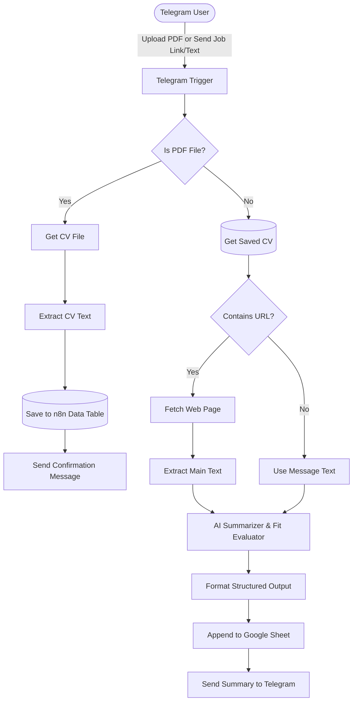

# 📋 n8n Job Posting Extractor & CV Matcher

An n8n automation workflow that lets you analyze job postings and match them against your resume directly through Telegram, saving every structured result to a Google Sheet. Powered by any cloud AI provider (OpenAI, OpenRouter, Groq, DeepSeek) or 100% local AI (Ollama, LM Studio).

---

## ⚡ How It Works

1. **Send your resume**: Upload your CV as a PDF to your Telegram bot. The bot extracts the text and securely stores it in an n8n Data Table.
2. **Send a job posting**: Send any job URL or paste a job description into Telegram.
3. **Get an instant breakdown**:
   - Web extraction (cleans away headers, footers, and page clutter).
   - Structured summary (Title, Pay, Required Skills, Education, Experience, Key Tasks).
   - CV Match assessment (**Fit**, **Partial fit**, **Miss**) listing specific strengths and gaps.
4. **Auto-archive**: Adds a row to your Google Sheets job tracker spreadsheet.



---

## 🚀 Quick Setup (3 Steps)

### Step 1: Import Workflow into n8n
1. In your n8n workspace, click **Add workflow** > **Import from File...**
2. Choose [`workflows/job-posting-extractor.json`](workflows/job-posting-extractor.json).

### Step 2: Create the `CV Store` Data Table
The workflow uses n8n's built-in Data Tables to store candidate resumes:
1. In n8n, navigate to **Data Tables** (in the left sidebar).
2. Click **Create Table** and name it: `CV Store`.
3. Add the following 4 columns:
   - `chat_id` (Type: **String**) &mdash; filter key to match the Telegram user.
   - `file_name` (Type: **String**) &mdash; name of the resume file.
   - `cv_text` (Type: **String**) &mdash; extracted text of the CV.
   - `uploaded_at` (Type: **String**) &mdash; upload timestamp.

*(See [`templates/datatable_schema.json`](templates/datatable_schema.json) for reference)*.

### Step 3: Link Your Credentials
Open the workflow in n8n and set up the 3 services:
1. **Telegram**:
   - Create a bot via `@BotFather` on Telegram to get your bot token.
   - Add your Telegram API credential in the `Telegram Trigger`, `Get CV File`, and message nodes.
2. **AI Model (Cloud or Local)**:
   - Link your credential in the **AI Chat Model** node.
   - **Cloud**: Use any provider (OpenAI, OpenRouter, Groq, DeepSeek).
   - **Local**: Point to Ollama (`http://localhost:11434/v1`) or LM Studio (`http://localhost:1234/v1`).
   - Enter your preferred model name (e.g. `gpt-4o-mini`, `deepseek-chat`, `llama3.2`, `mistral`).
3. **Google Sheets**:
   - Create a Google Sheet and add the headers from [`templates/google_sheets_template.csv`](templates/google_sheets_template.csv).
   - In the `Save to Google Sheet` node, select your Google OAuth/Service Account credential and paste your Spreadsheet ID.

Activate the workflow, send your CV PDF to your bot, and start sending job links!

---

## 📁 Repository Contents

```
.
├── workflows/
│   └── job-posting-extractor.json    # Complete n8n workflow file ready to import
├── templates/
│   ├── google_sheets_template.csv    # Column headers for your Google Sheet
│   └── datatable_schema.json         # n8n Data Table column definitions
├── docs/
│   └── setup-guide.md                # Detailed setup guide (Cloud & Local AI)
├── .gitignore
└── README.md
```

---

## 📊 Google Sheet Columns

The workflow writes the following fields to your tracking spreadsheet:

- `Date`: Extraction timestamp
- `Job Title`: Title as written in the posting
- `Pay`: Stated compensation or hourly rate
- `Tools & Skills`: Required and preferred skills
- `Education`: Minimum education required
- `Experience`: Required experience level
- `Other`: Clearances, licenses, work authorization
- `Key Tasks`: Bulleted list of responsibilities
- `Notes`: Clarifications or contradictory details
- `Link`: Job posting URL
- `CV Fit`: Fit verdict with matched skills and qualification gaps
